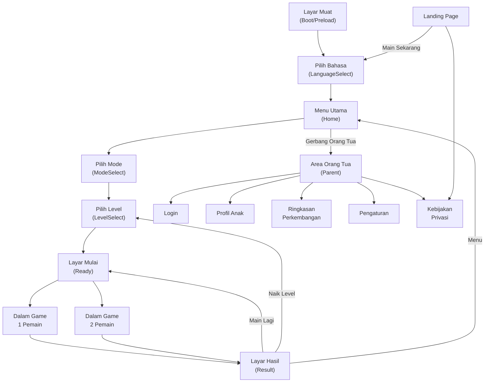

# 📑 Features & Pages — Play with Ms zia

> Dokumen ini mencantumkan semua halaman dan fitur beserta deskripsi singkat dan daftar komponen yang ada di dalamnya.

---

## Daftar Halaman

### 1. Layar Muat (Boot / Preload)

**Deskripsi:** Layar pertama saat aplikasi dibuka. Menampilkan logo dan bilah loading sambil memuat aset-aset dasar (font, ikon UI, audio inti).

**Komponen:**

| Komponen           | Deskripsi                                                                          |
| ------------------ | ---------------------------------------------------------------------------------- |
| `SplashBackground` | Latar kuning matahari dengan huruf dekoratif samar (A, B, 1, ا)                    |
| `MascotGreeting`   | Maskot Ms zia menyapa dengan balon ucapan "Hi!"                                    |
| `AppLogo`          | Logo "Play with Ms zia" dengan huruf bulat berwarna-warni dan tepi tebal           |
| `LoadingBar`       | Bilah muat berbentuk pil kuning di atas lavender muda, teks "Memuat…" / "Loading…" |

---

### 2. Pilih Bahasa (LanguageSelect)

**Deskripsi:** Anak (atau orang tua) memilih bahasa antarmuka. Pilihan disimpan dan bisa diubah kembali lewat gerbang orang tua. Tampil sekali di awal; setelahnya langsung ke Menu.

**Komponen:**

| Komponen         | Deskripsi                                                |
| ---------------- | -------------------------------------------------------- |
| `LanguageButton` | Dua tombol pil besar: 🇮🇩 Bahasa Indonesia dan 🇬🇧 English |
| `VoicePrompt`    | Suara Ms zia membacakan nama kedua bahasa                |
| `ScreenTitle`    | Teks "Pilih bahasa / Choose language"                    |

---

### 3. Menu Utama (Home)

**Deskripsi:** Beranda utama setelah memilih bahasa. Menampilkan seluruh 9 game dalam 4 kelompok keterampilan berbasis warna. Anak memilih game yang ingin dimainkan.

**Komponen:**

| Komponen        | Deskripsi                                                                                                     |
| --------------- | ------------------------------------------------------------------------------------------------------------- |
| `MascotBanner`  | Maskot Ms zia kecil di pojok dengan balon "Ayo main!" / "Let's play!"                                         |
| `SkillGroup`    | Kontainer per kelompok keterampilan dengan label berwarna (Angka 🔵, Huruf 🔴, Hijaiyyah 🟩, Ingat & Main 🟣) |
| `GameCard`      | Kartu per game: ubin ikon warna di kiri, nama game, 3 bintang pencapaian                                      |
| `StarBadge`     | Bintang terisi (kuning) atau kosong (lavender) menunjukkan pencapaian per game                                |
| `PlayerInfoBar` | Panel bawah: avatar anak (atau ikon tamu) dan total bintang                                                   |
| `HeaderBar`     | Pojok kanan atas: tombol bahasa 🌐, layar penuh ⛶, suara 🔊                                                   |
| `HomeButton`    | Pojok kiri atas: tombol beranda (disembunyikan di halaman ini karena sudah di home)                           |

**Kelompok & Game:**

| Kelompok     | Warna               | Game                                  |
| ------------ | ------------------- | ------------------------------------- |
| Angka        | Langit `#4DB8FF`    | Ayo Berhitung, Menulis Angka          |
| Huruf        | Karang `#FF6B6B`    | Susun Kata, Bunyi Awal, Menulis Huruf |
| Hijaiyyah    | Tosca `#3DE6CF`     | Dengar & Temukan, Tebalkan Hijaiyyah  |
| Ingat & Main | Lembayung `#9B8CFF` | Kartu Kembar, Petualangan Labirin     |

---

### 4. Pilih Mode (ModeSelect)

**Deskripsi:** Anak memilih bermain sendiri atau berdua. Tampil setelah memilih game dari menu.

**Komponen:**

| Komponen      | Deskripsi                                                              |
| ------------- | ---------------------------------------------------------------------- |
| `ModeButton`  | Dua tombol besar: 1 Pemain 👤 dan 2 Pemain 👤👤, dengan ikon sederhana |
| `ScreenTitle` | Judul "Pilih mode" / "Choose mode"                                     |
| `BackButton`  | Tombol kembali ke menu (pojok kiri atas)                               |

---

### 5. Pilih Level (LevelSelect)

**Deskripsi:** Anak memilih tingkat kesulitan. Semua level terbuka agar anak bebas memilih.

**Komponen:**

| Komponen      | Deskripsi                                                       |
| ------------- | --------------------------------------------------------------- |
| `LevelButton` | Tiga tombol berwarna: ★ Mudah, ★★ Sedang, ★★★ Menantang         |
| `LevelIcon`   | Ikon 1, 2, 3 bintang sebagai indikator visual tingkat kesulitan |
| `ScreenTitle` | Judul "Pilih level" / "Choose level"                            |
| `BackButton`  | Tombol kembali ke pilih mode                                    |

---

### 6. Layar Mulai (Ready)

**Deskripsi:** Layar terakhir sebelum bermain. Ms zia membacakan instruksi singkat, anak menekan tombol Mulai untuk memulai.

**Komponen:**

| Komponen            | Deskripsi                                                                |
| ------------------- | ------------------------------------------------------------------------ |
| `GameIllustration`  | Gambar besar bertema game yang akan dimainkan                            |
| `GameTitle`         | Judul game (misal "Ayo Berhitung")                                       |
| `StartButton`       | Tombol pil kuning besar "Klik Mulai" / "Click Start" dengan ikon panah ▶ |
| `VoiceInstruction`  | Ms zia membacakan instruksi cara bermain                                 |
| `ReplayAudioButton` | Tombol 🔊 untuk mengulang instruksi                                      |

---

### 7. Dalam Game — 1 Pemain

**Deskripsi:** Layar permainan utama mode 1 pemain. Layout bervariasi per game, tapi HUD dan elemen bantu tetap konsisten.

**Komponen:**

| Komponen          | Deskripsi                                                                                              |
| ----------------- | ------------------------------------------------------------------------------------------------------ |
| `GameHUD`         | Bar atas: tombol home 🏠 (dilindungi gerbang), bintang sesi ★★☆, tombol layar penuh ⛶, tombol suara 🔊 |
| `GameArea`        | Area tengah: konten soal/pilihan/interaksi, bervariasi per game                                        |
| `MascotHelper`    | Maskot Ms zia kecil di pojok bawah kiri + balon petunjuk                                               |
| `ReplayButton`    | Tombol 🔁 untuk mengulang soal/instruksi                                                               |
| `FeedbackOverlay` | Overlay animasi saat benar (kilau + bintang terbang) atau salah (goyang lembut)                        |
| `IdlePrompt`      | Setelah 30 detik tanpa sentuhan: maskot menunjuk, jawaban benar berkedip pelan, instruksi diulang      |
| `PauseOverlay`    | Setelah 2 menit tanpa sentuhan: game berhenti sementara                                                |

---

### 8. Dalam Game — 2 Pemain (Duel)

**Deskripsi:** Layar permainan mode duel. Layar dibagi dua zona warna berbeda; tiap pemain punya area dan skor sendiri.

**Komponen:**

| Komponen          | Deskripsi                                                                  |
| ----------------- | -------------------------------------------------------------------------- |
| `DuelSplitScreen` | Pembagi layar jadi dua zona (biru & oranye lembut) dengan garis tengah     |
| `PlayerZone`      | Area per pemain: latar warna berbeda, soal, dan pilihan sendiri            |
| `PlayerScoreHUD`  | Skor bintang per pemain di sudut masing-masing                             |
| `TurnIndicator`   | Sorotan warna untuk game bergilir (Kartu Kembar) menunjukkan giliran siapa |
| `MascotCenter`    | Maskot Ms zia di tengah atas                                               |
| `TouchIsolation`  | Sistem: sentuhan di area pemain lain diabaikan, palm rejection             |
| `GameHUD`         | Tombol home, layar penuh, suara (posisi tetap di luar zona pemain)         |

---

### 9. Layar Hasil (Result)

**Deskripsi:** Tampil setelah satu putaran game selesai. Menampilkan bintang yang didapat dan pilihan lanjutan.

**Komponen:**

| Komponen          | Deskripsi                                                                                                   |
| ----------------- | ----------------------------------------------------------------------------------------------------------- |
| `StarReveal`      | Bintang besar muncul satu per satu dengan animasi dan suara fanfare                                         |
| `MascotCheer`     | Maskot Ms zia bertepuk tangan                                                                               |
| `PlayAgainButton` | Tombol "Main Lagi" / "Play Again"                                                                           |
| `NextLevelButton` | Tombol "Naik Level" / "Next Level" (jika bukan level tertinggi)                                             |
| `MenuButton`      | Tombol "Menu" / kembali ke beranda                                                                          |
| `DuelResult`      | (Mode 2 pemain) Pemenang disorot dengan mahkota; seri ditampilkan khusus; kedua anak tetap mendapat bintang |

---

### 10. Halaman Orang Tua (Parent Area)

**Deskripsi:** Area khusus orang tua di balik gerbang orang tua. Berisi login, profil anak, ringkasan perkembangan, dan pengaturan.

**Komponen:**

| Komponen              | Deskripsi                                                                |
| --------------------- | ------------------------------------------------------------------------ |
| `ParentGate`          | Gerbang: tahan 3 detik (cincin pengisi) atau jawab soal hitung sederhana |
| `LoginForm`           | Form login: email magic link / OTP, opsional Google OAuth                |
| `ChildProfileList`    | Daftar profil anak: nama panggilan + avatar                              |
| `AddChildForm`        | Tambah profil anak baru: isi nama panggilan, pilih avatar                |
| `ProgressSummary`     | Ringkasan perkembangan per anak per keterampilan                         |
| `MilestoneCard`       | Kartu capaian "Sudah bisa…" per keterampilan                             |
| `TrainingIndicator`   | Indikator "Sedang dilatih" untuk keterampilan belum tercapai             |
| `SettingsPanel`       | Pengaturan: ganti bahasa, volume, kurangi gerak                          |
| `DeleteAccountButton` | Hapus profil anak atau seluruh akun                                      |
| `DataSyncStatus`      | Status sinkronisasi data (online/offline)                                |

---

### 11. Halaman Kebijakan Privasi (Privacy Policy)

**Deskripsi:** Halaman statis berisi kebijakan privasi dalam dua bahasa. Dapat diakses dari area orang tua.

**Komponen:**

| Komponen         | Deskripsi                                                                |
| ---------------- | ------------------------------------------------------------------------ |
| `PrivacyContent` | Teks kebijakan privasi (data apa yang disimpan, di mana, cara menghapus) |
| `LanguageToggle` | Tombol ganti bahasa kebijakan (ID / EN)                                  |
| `BackButton`     | Kembali ke area orang tua                                                |

---

### 12. Landing Page

**Deskripsi:** Halaman pembuka web untuk pengunjung baru. Menjelaskan apa itu Play with Ms zia dan mengarahkan ke game.

**Komponen:**

| Komponen            | Deskripsi                                                     |
| ------------------- | ------------------------------------------------------------- |
| `HeroBanner`        | Ilustrasi besar maskot + logo + tagline                       |
| `FeatureHighlights` | Ikon dan deskripsi singkat 4 kelompok keterampilan            |
| `PlayNowButton`     | Tombol CTA besar "Main Sekarang" / "Play Now" → masuk ke game |
| `Footer`            | Link ke kebijakan privasi, info kontak                        |

---

## Daftar Fitur

### Fitur Umum (Semua Game)

| Kode | Fitur                   | Deskripsi                                                                                                                           | Komponen Utama                            |
| ---- | ----------------------- | ----------------------------------------------------------------------------------------------------------------------------------- | ----------------------------------------- |
| U-01 | Pilih Bahasa            | Dua bahasa: Indonesia & Inggris. Semua teks dan suara mengikuti pilihan. Bisa diubah lewat gerbang orang tua.                       | `LanguageButton`, `VoicePrompt`           |
| U-02 | Layar Mulai             | Tombol besar "Klik Mulai" / "Click Start" + ikon panah dan suara instruksi sebelum setiap game dimulai.                             | `StartButton`, `VoiceInstruction`         |
| U-03 | Pilih Level             | Tiga tingkat: Mudah (★), Sedang (★★), Menantang (★★★). Semua level terbuka, tidak terkunci.                                         | `LevelButton`, `LevelIcon`                |
| U-04 | Pilih Mode              | Mode 1 Pemain (solo) dan 2 Pemain (duel) di satu layar.                                                                             | `ModeButton`                              |
| U-05 | Layar Penuh             | Tombol di pojok kanan atas untuk Fullscreen API. Disembunyikan di iPhone Safari; PWA standalone sebagai alternatif.                 | `FullscreenButton`                        |
| U-06 | Pemandu Suara           | Ms zia membacakan instruksi dan umpan balik. Tombol speaker untuk mengulang. Antrean suara agar tidak bertabrakan.                  | `VoiceGuide`, `ReplayAudioButton`         |
| U-07 | Umpan Balik Benar/Salah | Benar: animasi kilau + suara ceria + bintang. Salah: goyang lembut + "coba lagi". Tanpa suara negatif atau nilai merah.             | `FeedbackOverlay`, `StarAnimation`        |
| U-08 | Layar Hasil             | Bintang muncul satu per satu. Tombol: Main Lagi, Naik Level, Menu. Duel: pemenang + mahkota, seri khusus, kedua anak dapat bintang. | `StarReveal`, `MascotCheer`, `DuelResult` |
| U-09 | Tombol Beranda          | Selalu ada di pojok kiri atas, dilindungi gerbang orang tua agar anak tidak keluar tak sengaja.                                     | `HomeButton`, `ParentGate`                |
| U-10 | Gerbang Orang Tua       | Tahan 3 detik (cincin pengisi) atau jawab soal hitung sederhana. Melindungi pengaturan, login, dan keluar game.                     | `ParentGate`                              |
| U-11 | Jeda Otomatis           | 30 detik tanpa sentuhan: maskot menunjuk + instruksi diulang. 2 menit: game berhenti sementara.                                     | `IdlePrompt`, `PauseOverlay`              |
| U-12 | Simpan Level Terakhir   | Level terakhir per game tersimpan di perangkat (localStorage). Jika orang tua login, tersimpan juga di Supabase.                    | `Storage`                                 |

---

### Fitur Akun Orang Tua

| Kode | Fitur                    | Deskripsi                                                                                                                 | Komponen Utama                                          |
| ---- | ------------------------ | ------------------------------------------------------------------------------------------------------------------------- | ------------------------------------------------------- |
| U-13 | Mode Tamu                | Semua game bisa dimainkan penuh tanpa login. Data tersimpan di perangkat.                                                 | `Storage` (localStorage + IndexedDB)                    |
| U-14 | Akun Orang Tua           | Daftar/masuk lewat email magic link atau OTP di balik gerbang orang tua. Opsional Google OAuth. Tanpa kata sandi.         | `LoginForm`, `ParentGate`                               |
| U-15 | Profil Anak              | Orang tua menambah profil anak: nama panggilan + avatar (tanpa nama asli/tanggal lahir). Dipilih dari menu.               | `ChildProfileList`, `AddChildForm`                      |
| U-16 | Simpan Data Bermain      | Hasil putaran (game, level, benar/total, durasi) tersimpan ke profil anak. Data tamu bisa dipindahkan saat login pertama. | `Storage`, Supabase `rounds` table                      |
| U-17 | Ringkasan Perkembangan   | Halaman orang tua: capaian per keterampilan ("Sudah bisa berhitung sampai 10") dan keterampilan yang sedang dilatih.      | `ProgressSummary`, `MilestoneCard`, `TrainingIndicator` |
| U-18 | Hapus Data               | Hapus profil anak (CASCADE) atau seluruh akun beserta data.                                                               | `DeleteAccountButton`, Supabase Edge Function           |
| U-19 | Lanjut di Perangkat Lain | Level dan bintang tersinkron saat orang tua login di perangkat berbeda.                                                   | `DataSyncStatus`                                        |

---

### Fitur Game — Hijaiyyah 🟩

| Kode | Game                       | Deskripsi                                                                                                                                                                       | Komponen Utama                                                    |
| ---- | -------------------------- | ------------------------------------------------------------------------------------------------------------------------------------------------------------------------------- | ----------------------------------------------------------------- |
| H-01 | Dengar & Temukan Hijaiyyah | Ms zia ucapkan bunyi huruf, anak ketuk huruf yang benar dari pilihan. Level menentukan jumlah pilihan (2/3/4) dan huruf yang dipakai (10/20/28).                                | `ChoiceRound`, `VoiceGuide`, `ReplayAudioButton`, `HijaiyyahCard` |
| H-02 | Tebalkan Hijaiyyah         | Huruf hijaiyyah ditampilkan sebagai garis putus-putus. Anak menelusuri dengan jari, garis berubah tebal berwarna. Level menentukan lebar jalur dan bantuan (panah, titik awal). | `TracingEngine`, `TracingCanvas`, `StrokeGuide`, `DotTarget`      |

**Komponen spesifik Hijaiyyah:**

| Komponen        | Deskripsi                                                   |
| --------------- | ----------------------------------------------------------- |
| `HijaiyyahCard` | Kartu huruf hijaiyyah besar (160–200px) dalam bingkai tosca |
| `TracingCanvas` | Canvas tempat anak menelusuri jalur huruf                   |
| `StrokeGuide`   | Panah arah goresan (level Mudah)                            |
| `DotTarget`     | Titik nuqtah hijaiyyah sebagai target ketuk terpisah        |
| `StrokeTrail`   | Jejak tebal berwarna saat jari menelusuri jalur             |

---

### Fitur Game — Angka 🔵

| Kode | Game          | Deskripsi                                                                                                                                                | Komponen Utama                                                             |
| ---- | ------------- | -------------------------------------------------------------------------------------------------------------------------------------------------------- | -------------------------------------------------------------------------- |
| A-01 | Ayo Berhitung | Benda (buah, hewan, balon) tampil di layar. Anak ketuk satu per satu → benda masuk keranjang + Ms zia sebut angkanya. Lalu cocokkan jumlah dengan angka. | `CountableObject`, `Basket`, `VoiceGuide`, `ChoiceRound`, `CounterDisplay` |
| A-02 | Menulis Angka | Angka ditampilkan sebagai jalur putus-putus. Anak menelusuri dengan jari. Dua digit ditulis berurutan di level Menantang.                                | `TracingEngine`, `TracingCanvas`, `StrokeGuide`, `ConfettiEffect`          |

**Komponen spesifik Angka:**

| Komponen          | Deskripsi                                                          |
| ----------------- | ------------------------------------------------------------------ |
| `CountableObject` | Benda yang bisa diketuk untuk dihitung (buah, hewan, balon)        |
| `Basket`          | Keranjang tempat benda yang sudah dihitung bergerak ke dalamnya    |
| `CounterDisplay`  | Tampilan angka yang sudah dihitung                                 |
| `CountedMarker`   | Penanda visual benda yang sudah dihitung agar tidak dihitung ulang |
| `ConfettiEffect`  | Konfeti kecil saat angka selesai ditulis                           |

---

### Fitur Game — Huruf 🔴

| Kode | Game          | Deskripsi                                                                                                           | Komponen Utama                                                        |
| ---- | ------------- | ------------------------------------------------------------------------------------------------------------------- | --------------------------------------------------------------------- |
| L-01 | Susun Kata    | Gambar benda ditampilkan, Ms zia mengeja huruf demi huruf. Anak menyeret kepingan huruf ke kotak urutan yang benar. | `WordImage`, `LetterTile`, `DropZone`, `VoiceGuide`, `DistractorTile` |
| L-02 | Bunyi Awal    | Ms zia sebut kata + gambar. Anak ketuk huruf pertama dari kata itu.                                                 | `ChoiceRound`, `WordImage`, `VoiceGuide`, `LetterOption`              |
| L-03 | Menulis Huruf | Huruf besar (A–Z) dan kecil (a–z) sebagai jalur putus-putus. Warna jejak berbeda tiap goresan.                      | `TracingEngine`, `TracingCanvas`, `StrokeGuide`, `MultiColorTrail`    |

**Komponen spesifik Huruf:**

| Komponen          | Deskripsi                                                             |
| ----------------- | --------------------------------------------------------------------- |
| `WordImage`       | Gambar besar benda/kata yang ditampilkan sebagai soal                 |
| `LetterTile`      | Kepingan huruf berwarna yang bisa diseret                             |
| `DropZone`        | Kotak target tempat huruf dijatuhkan, menyala hijau lembut saat benar |
| `DistractorTile`  | Huruf pengecoh (level Sedang & Menantang)                             |
| `GhostLetter`     | Huruf samar di dalam kotak sebagai petunjuk (level Mudah)             |
| `LetterOption`    | Pilihan huruf dalam bentuk kotak besar untuk game Bunyi Awal          |
| `MultiColorTrail` | Jejak berwarna berbeda per goresan saat menulis huruf                 |

---

### Fitur Game — Daya Ingat & Game 🟣

| Kode | Game                | Deskripsi                                                                                                                                 | Komponen Utama                                                               |
| ---- | ------------------- | ----------------------------------------------------------------------------------------------------------------------------------------- | ---------------------------------------------------------------------------- |
| G-01 | Kartu Kembar        | Kartu tertutup dalam grid. Ketuk 2 kartu untuk membalik; cocok = tetap terbuka, beda = tutup lagi. Selesai saat semua pasangan ditemukan. | `FlipCard`, `CardGrid`, `MatchChecker`, `PeekTimer`                          |
| G-02 | Petualangan Labirin | Geser karakter dengan jari melewati labirin menuju makanan. Dinding tidak mematikan, karakter hanya berhenti dan bergetar.                | `MazeGrid`, `PlayerCharacter`, `FoodGoal`, `WallCollider`, `StarCollectible` |

**Komponen spesifik Daya Ingat:**

| Komponen          | Deskripsi                                                                                   |
| ----------------- | ------------------------------------------------------------------------------------------- |
| `FlipCard`        | Kartu yang bisa dibalik: punggung bermotif bintang, muka berisi gambar                      |
| `CardGrid`        | Grid kartu: 2×3 (Mudah), 3×4 (Sedang), 4×5 (Menantang)                                      |
| `MatchChecker`    | Logika pencocokan: dua kartu sama = tetap terbuka + kedipan, beda = tutup setelah 1,5 detik |
| `PeekTimer`       | Level Menantang: semua kartu dibuka 2 detik di awal lalu ditutup                            |
| `MazeGrid`        | Grid labirin berwarna lembut: 5×5, 7×7, atau 9×9                                            |
| `PlayerCharacter` | Karakter anak/hewan yang digeser dengan jari                                                |
| `FoodGoal`        | Makanan enak di ujung labirin sebagai tujuan                                                |
| `WallCollider`    | Deteksi tabrakan dinding: karakter berhenti + bergetar pelan                                |
| `StarCollectible` | 3 bintang yang bisa dikumpulkan di labirin (level Menantang)                                |
| `MazeGenerator`   | Algoritma recursive backtracker untuk membuat labirin acak yang selalu solvable             |

---

## Komponen Bersama (Shared Components)

Komponen yang dipakai ulang di banyak halaman dan game:

| Komponen           | Deskripsi                                                                                                    | Dipakai di                           |
| ------------------ | ------------------------------------------------------------------------------------------------------------ | ------------------------------------ |
| `GameBase`         | Kelas induk semua game: menerima config, kelola HUD, skor, umpan balik, bantuan otomatis, transisi ke Result | Semua 9 game                         |
| `TracingEngine`    | Mesin telusur jalur goresan: muat polyline, deteksi jari, toleransi per level, animasi jejak                 | H-02, A-02, L-03                     |
| `ChoiceRound`      | Tampilkan N pilihan, deteksi ketukan, umpan balik benar/salah, kedipan bantuan                               | H-01, A-01, L-02                     |
| `DuelSplitScreen`  | Bagi layar dua zona, isolasi sentuhan, HUD per pemain                                                        | Semua game mode 2 pemain             |
| `VoiceGuide`       | Antrean suara Ms zia, putar sesuai bahasa, tombol ulang, fallback jika gagal                                 | Semua halaman & game                 |
| `ParentGate`       | Overlay DOM: tahan 3 detik atau soal hitung. Melindungi pengaturan dan keluar                                | Menu, dalam game, area orang tua     |
| `Storage`          | Pembungkus localStorage & IndexedDB: bahasa, volume, level, antrean data bermain                             | Seluruh aplikasi                     |
| `FullscreenButton` | Tombol layar penuh (Fullscreen API + fallback)                                                               | Semua halaman                        |
| `MuteButton`       | Tombol bisukan/nyalakan suara                                                                                | Semua halaman                        |
| `HomeButton`       | Tombol kembali ke beranda, dilindungi gerbang                                                                | Semua halaman kecuali Home           |
| `BackButton`       | Tombol kembali ke layar sebelumnya                                                                           | ModeSelect, LevelSelect, Parent Area |
| `StarDisplay`      | Tampilan bintang (terisi kuning / kosong lavender)                                                           | Menu, HUD, Result                    |
| `ScreenTransition` | Animasi geser/pudar halus antar layar (300ms)                                                                | Semua perpindahan layar              |
| `OrientationGuard` | Deteksi orientasi potret → tampilkan petunjuk putar layar                                                    | Seluruh aplikasi                     |
| `AudioUnlock`      | Memicu Web Audio context saat sentuhan pertama (iOS requirement)                                             | Layar bahasa / Mulai                 |
| `FeedbackOverlay`  | Overlay animasi benar (kilau, bintang terbang ≤ 800ms) dan salah (goyang ≤ 400ms)                            | Semua game                           |
| `Analytics`        | Pembungkus peristiwa anonim, bisa dimatikan, tanpa cookie                                                    | Seluruh aplikasi                     |

---

## Peta Alur Halaman

---

## Ringkasan Jumlah

| Kategori               | Jumlah |
| ---------------------- | ------ |
| Halaman / Layar        | 12     |
| Game                   | 9      |
| Fitur umum (U-xx)      | 19     |
| Kelompok keterampilan  | 4      |
| Level per game         | 3      |
| Mode pemain            | 2      |
| Bahasa                 | 2      |
| Komponen bersama       | 16     |
| Komponen spesifik game | 25+    |
