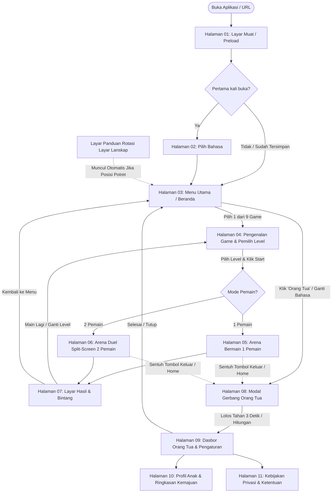

# PRD Halaman (page.prd) — Play with Ms zia

Dokumen ini mendefinisikan seluruh halaman (layar), diagram alur pengguna (_screen flowchart_), dan rincian konten tiap halaman pada aplikasi **Play with Ms zia** (usia 4–6 tahun). Desain mengusung pendekatan **clean, minimalist, and simple** (estetika Skandinavia untuk anak-anak, mengedepankan ketenangan visual, ruang bernapas lapang, dan warna-warna lembut).

---

## 1. Diagram Alur Halaman (Page Flowchart)

---

## 2. Daftar & Rincian Konten Setiap Halaman

---

### Halaman 01: Layar Muat (Preload / Boot)

- **Tujuan:** Menyiapkan aset grafis, web fonts, dan audio sprite di memori peramban dalam suasana yang tenang dan menyenangkan.
- **Isi & Elemen:**
  - Kanvas latar belakang warm white polos (`#FAF8F5`), bebas dari pola berulang, confetti, atau huruf dekoratif melayang yang membingungkan mata anak.
  - Ilustrasi minimalis maskot **Ms zia** tersenyum hangat dengan balon sapaan sederhana _"Halo! / Hello!"_.
  - Logo utama _"Play with Ms zia"_ bergaya modern bersih (font Fredoka SemiBold warna Deep Navy `#1F2A5C`, tanpa garis outline tebal gelembung).
  - Bilah kemajuan (_progress bar_) berbentuk kapsul ramping berlatar abu terang (`#F3F1EE`) dengan pengisi bertahap warna emas hangat (`#FFD200`) dan teks ringkas _"Memuat… / Loading…"_.
  - Deteksi orientasi otomatis (mengalihkan ke layar panduan rotasi jika perangkat dalam orientasi potret).

---

### Halaman 02: Pemilih Bahasa Awal (Language Select)

- **Tujuan:** Menentukan bahasa instruksi suara dan antarmuka saat aplikasi pertama kali dijalankan.
- **Isi & Elemen:**
  - Judul ramah di bagian atas: _"Pilih Bahasa / Choose Language"_ (Fredoka SemiBold, Deep Navy).
  - Dua kartu pilihan raksasa berlatar putih bersih (`#FFFFFF`), sudut lengkung 16 px, dan bayangan lembut tanpa garis tepi tebal:
    1. 🇮🇩 **Bahasa Indonesia** — lencana bendera minimalis + label jelas.
    2. 🇬🇧 **English** — lencana bendera minimalis + label jelas.
  - Efek suara pengucapan nama bahasa dengan intonasi hangat dan ramah saat kartu disentuh.
  - Preferensi langsung tersimpan di penyimpanan lokal (_localStorage_) dan layar bertransisi halus ke Beranda.

---

### Halaman 03: Menu Utama (Beranda / Home Screen)

- **Tujuan:** Pusat navigasi utama anak untuk memilih 9 permainan, melihat capaian bintang, dan memilih mode permainan dalam tata letak yang lapang (_breathable_).
- **Isi & Elemen:**
  - **Header Bar Atas (Ramping & Bersih):**
    - Sisi Kiri: Avatar bulat maskot Ms zia (40×40 px, border halus 2 px putih, soft shadow) berdampingan dengan logo teks clean _"Play with Ms zia"_.
    - Sisi Kanan (Tombol Utilitas Kapsul `#F3F1EE` tanpa border tebal): Pemilih Bahasa (`ID/EN` berikon gembok kecil 🔒), Tombol Layar Penuh (`⛶`), dan Tombol Suara (`🔊`).
  - **Baris Tab Kategori (Filter Bar Minimalis):**
    - Kapsul pill ramping (tinggi ~40 px, gap 10 px), aktif berlatar putih murni dengan bayangan halus, inaktif transparan dengan teks abu-abu lembut (`#9CA3AF`):
      1. ☀️ **Semua Mainan** (menampilkan seluruh 9 game).
      2. 🔢 **Angka** (filter 2 game angka).
      3. 🔤 **Huruf** (filter 3 game huruf).
      4. 🌙 **Hijaiyyah** (filter 2 game hijaiyyah).
      5. 🧩 **Ingat & Main** (filter 2 game memori/labirin).
  - **Grid Permainan (9 Kartu Permainan Minimalis):**
    - Tata letak grid 3 kolom × 3 baris terpusat, jarak antar kartu 16–20 px.
    - Kartu berlatar putih solid (`#FFFFFF`), sudut membulat 16 px, bayangan lembut (`box-shadow: 0 2px 16px rgba(31, 42, 92, 0.05)`), tanpa border tebal navy:
      1. _Ayo Berhitung_ (Kategori Angka · Biru Lembut · Ikon: Ilustrasi line-art 3 buah di wadah biru pastel 10%).
      2. _Menulis Angka_ (Kategori Angka · Biru Lembut · Ikon: Angka 5 rapi dengan titik goresan).
      3. _Susun Kata_ (Kategori Huruf · Karang Lembut · Ikon: 3 balok huruf [A][P][L] beraksen coral transparan).
      4. _Bunyi Awal_ (Kategori Huruf · Karang Lembut · Ikon: Simbol pendengaran fonik huruf B).
      5. _Menulis Huruf_ (Kategori Huruf · Karang Lembut · Ikon: Huruf A jejak garis panduan tipis).
      6. _Dengar & Temukan_ (Kategori Hijaiyyah · Tosca Lembut · Ikon: Huruf ب & speaker line-art).
      7. _Tebalkan Hijaiyyah_ (Kategori Hijaiyyah · Tosca Lembut · Ikon: Huruf ج garis putus-putus beraksen titik pandu).
      8. _Kartu Kembar_ (Kategori Ingat & Main · Lembayung Lembut · Ikon: Sepasang kartu datar minimalis & bintang).
      9. _Petualangan Labirin_ (Kategori Ingat & Main · Lembayung Lembut · Ikon: Labirin geometris minimalis & bendera finis).
    - Tiap kartu dilengkapi lencana kategori pastel halus, judul Fredoka SemiBold (Deep Navy), dan 3 bintang capaian datar (emas `#FFD200` terisi / abu netral `#E5E7EB` kosong, tanpa garis tepi gelap).
  - **Dock Status Bawah (Floating Pill):**
    - Panel melayang berlatar putih (`#FFFFFF`) dengan bayangan halus ke atas dan sudut 20 px:
      - Modul Profil Anak: Avatar bulat 32 px + Nama _"Adik Bintang"_ + Subteks streak _"🔥 3 hari berturut"_.
      - Modul Bintang: Ikon bintang emas minimalis + hitungan koleksi _"12 Bintang"_.
      - Switcher Mode Ramping: Segmented control kapsul `[ 👤 1 Pemain ]` vs `[ 👥 2 Pemain ]`.
      - Tombol Area Orang Tua: Kapsul abu netral dengan ikon gembok 🔒 dan teks _"Orang Tua"_ (_"Tahan 3 Detik"_).

---

### Halaman 04: Pengenalan Game & Pemilih Level (Game Intro & Level Select)

- **Tujuan:** Menyajikan ruang persiapan awal yang tenang dan bebas intimidasi, tempat anak dapat melihat ilustrasi karakter game, menyimak panduan suara, memilih tingkat kesulitan, dan langsung menekan tombol mulai dalam **satu tampilan kartu terpusat yang lapang tanpa berpindah layar**.
- **Prinsip Estetika & Ketenangan (Anti-Ramai):** Mengedepankan ruang bernapas lapang (_generous white space_), kontras warna pastel lembut, tanpa ornamen berisik (tanpa animasi kilat, partikel melayang, atau konfeti berlebihan) agar anak tetap rileks dan fokus pada materi bermain.
- **Tata Letak & Komponen Visual (Sesuai Referensi Desain):**
  - **Latar Luar Layar (Backdrop):** Warna _warm white_ lembut (`#FAF8F5`) yang hangat dan menenangkan mata anak.
  - **Navigasi Kembali (Sudut Kiri Atas):**
    - Tombol tautan panah minimalis: `← All games` (atau `← Semua Mainan`) dengan tipografi ramping dan padding sentuh yang nyaman untuk kembali ke Menu Utama/Beranda.
  - **Kartu Kontainer Utama (Center Modal Card):**
    - Terpusat di tengah layar lanskap dengan sudut membulat tegas (_rounded corner radius_ ~24–28 px), garis outline tepi rapi (1.5–2 px _deep navy / charcoal_), dan bayangan halus (`box-shadow: 0 4px 24px rgba(31, 42, 92, 0.06)`).
    - Terbagi menjadi dua area vertikal yang harmonis dan terstruktur:
    1. **Banner Ilustrasi Atas (Header Area):**
       - Latar header kartu berupa blok warna pastel lembut sesuai tema/kategori game (contoh pada referensi: warna lavender lembut `#EDE9FE` untuk kategori huruf; _soft sky blue_ untuk angka; _mint tosca_ untuk hijaiyyah).
       - Sudut atas membulat mengikuti lengkungan kartu utama.
       - **Tombol Utilitas Cepat (Sudut Kanan Atas):** Tombol lingkaran putih kecil berikon roda gigi minimalis (`⚙️`) untuk akses cepat pengaturan audio/bantuan.
       - **Ilustrasi Karakter Tematik (Flat Art Modern):**
         - Komposisi ilustrasi karakter bergaya _flat 2D_ yang manis, tenang, dan proporsional (contoh: Apel merah berwajah ceria 🍎, Maskot Kucing oranye Ms Ziya 🐱 di tengah, dan Anak Anjing lucu 🐶).
         - Memberikan sambutan visual yang ramah tanpa efek visual menyilaukan.

    2. **Area Konten & Kontrol Bawah (Clean White Area):**
       - Latar putih bersih murni (`#FFFFFF`) dengan jarak antar elemen yang lega (_breathable layout_).
       - **Judul Permainan (Game Title):**
         - Teks judul tebal terpusat (contoh: _"Write letters"_ / _"Menulis Huruf"_), font Fredoka SemiBold warna Deep Navy (`#1F2A5C`), ukuran ramah anak (24–28 px).
       - **Petunjuk Cara Bermain (Instruksi Singkat):**
         - Kalimat ringkas 1–2 baris yang santai dan jelas (contoh: _"Watch how the letter is written. Then trace it with your finger, starting at the green dot."_ / _"Perhatikan cara menulis hurufnya, lalu tebalkan dengan jarimu mulai dari titik hijau ya!"_), font Nunito warna abu-abu netral (`#6B7280`).
       - **Tombol Dengar Panduan Suara:**
         - Tombol teks horizontal berikon speaker minimalis: `🔊 Hear how to play` / `🔊 Dengarkan cara bermain`.
         - Memutar narasi suara hangat Ms Ziya untuk membimbing anak usia 4–6 tahun yang belum lancar membaca.
       - **Pemilih Tingkat Kesulitan (Level Selector):**
         - Label pengantar kecil terpusat di atas pilihan: _"Pick a level"_ (font Nunito warna netral).
         - Tiga tombol kapsul horizontal berjajar lega dengan indikator bintang:
           - ★☆☆ **Mudah (Easy):** 1 bintang terisi.
           - ★★☆ **Sedang (Medium):** 2 bintang terisi.
           - ★★★ **Menantang (Tricky):** 3 bintang terisi.
         - _Status Visual Level:_
           - **Level Aktif / Terpilih (Selected):** Berlatar warna hijau pastel segar (`#86EFAC` / `#74D95B`), teks tebal, dan border tegas.
           - **Level Belum Terpilih (Unselected):** Berlatar putih bersih (`#FFFFFF`), border rounded tipis netral, dan teks abu-abu gelap.
           - Seluruh level terbuka bebas (tanpa sistem gembok paksaan). Mengetuk kartu langsung mengubah pilihan aktif secara instan di tempat.
       - **Tombol Aksi Utama Mulai (Start Button):**
         - Kapsul besar (_pill button_) terpusat tepat di bawah pemilih level.
         - Berlatar ungu/periwinkle lembut yang tegas dan kontras (`#6366F1` / `#7C3AED`), kontras tinggi namun tidak menyilaukan/neon.
         - Teks putih tebal: **"▶ Start"** / **"▶ Mulai"**.
         - Berukuran besar (tinggi 52–58 px), sangat mudah ditekan motorik anak.
         - Sekali sentuh langsung memulai permainan sesuai level yang aktif menuju Arena Bermain (Halaman 05 / 06).

---

### Halaman 05: Arena Bermain — Mode 1 Pemain (Single Player Stage)

- **Tujuan:** Kanvas interaktif bebas distraksi tempat anak fokus belajar dan bermain secara mandiri.
- **Isi & Elemen:**
  - **Top HUD Bar Rapi:** Tombol Keluar/Beranda (dilindungi verifikasi gerbang orang tua), penanda kemajuan putaran berupa bintang emas kecil, tombol layar penuh, dan tombol bisukan suara.
  - **Kanvas Interaksi Tengah (Sesuai Ragam Permainan):**
    - _Tracing (H-02, A-02, L-03):_ Garis putus-putus ramping presisi, titik awal berkilau lembut, jejak goresan jari berwarna pastel yang mengisi jalur secara alami.
    - _Game Pilihan (H-01, L-02):_ Kartu-kartu pilihan berukuran besar (≥ 160 px), jarak lega (≥ 24 px), permukaan putih berbayangan lembut, speaker dengar ulang bunyi kata.
    - _Ayo Berhitung (A-01):_ Objek buah/hewan dengan ilustrasi line-art bersih yang bergerak mulus ke keranjang minimalis saat disentuh.
    - _Susun Kata (L-01):_ Gambar soal bersih, kotak slot huruf dengan outline 1 px tipis, kepingan huruf bulat yang nyaman digeser.
    - _Kartu Kembar (G-01):_ Grid kartu tertutup bertekstur tenang (motif bintang datar), animasi pembalikan kartu 3D halus (300 ms).
    - _Petualangan Labirin (G-02):_ Lorong labirin bernuansa pastel hangat, karakter yang digerakkan sentuhan jari, dinding batas yang bergetar lembut jika tersentuh.
  - **Asisten Maskot Ms zia:** Di sudut bawah memberikan ekspresi penyemangat tenang; balon petunjuk lembut muncul otomatis jika anak diam selama > 30 detik.

---

### Halaman 06: Arena Bermain — Mode 2 Pemain (Duel Split-Screen)

- **Tujuan:** Media belajar dan bermain bersama saudara/teman sebaya secara langsung pada satu layar tablet.
- **Isi & Elemen:**
  - Layar terbagi dua zona simetris dengan warna latar pastel yang sangat lembut dan ramah penglihatan anak:
    - **Sisi Kiri / Bawah (Pemain 1):** Latar bernuansa biru pastel sangat muda (`rgba(77, 184, 255, 0.08)`).
    - **Sisi Kanan / Atas (Pemain 2):** Latar bernuansa coral/oranye pastel sangat muda (`rgba(255, 107, 107, 0.08)`).
  - Garis batas pemisah tipis 1 px netral (`#E8E4DF`) di tengah layar.
  - Isolasi sentuhan _multi-touch_ penuh: Ketukan jari Pemain 1 tidak mengganggu atau membatalkan sentuhan Pemain 2.
  - Indikator skor minimalis berupa bintang mini di sudut wilayah masing-masing pemain.
  - _Pada Kartu Kembar (Bergiliran):_ Sorotan cahaya lembut (_gentle spotlight_) menandai pemain yang sedang mendapat giliran bermain.

---

### Halaman 07: Layar Hasil & Bintang (Result Screen)

- **Tujuan:** Memberikan apresiasi penuh atas usaha anak dengan nuansa selebrasi yang hangat dan menyenangkan.
- **Isi & Elemen:**
  - Animasi maskot Ms zia bertepuk tangan riang dengan partikel kilau lembut (_subtle sparkles_) tanpa ledakan konfeti berlebihan.
  - Bintang capaian (1 hingga 3 bintang emas `#FFD200`) muncul berurutan dengan animasi elastis ringan dan nada arpeggio manis.
  - Pujian verbal hangat dari Ms zia: _"Hebat sekali!", "Bagus!", "Kamu pintar!"_.
  - _Pada Mode 2 Pemain:_ Mahkota emas kecil menandai pemain dengan capaian tertinggi, namun **kedua anak tetap menerima bintang hadiah yang sama membanggakannya**.
  - **Tiga Tombol Navigasi Kapsul di Bawah:**
    1. 🔁 **Main Lagi** (mengulang putaran pada level yang sama).
    2. ⬆️ **Naik Level** (melangkah ke tingkat tantangan berikutnya / kembali ke pemilih level).
    3. 🏠 **Menu** (kembali ke Menu Utama).

---

### Halaman 08: Modal Gerbang Orang Tua (Parental Gate)

- **Tujuan:** Mencegah anak keluar dari aplikasi atau mengubah setelan penting secara tidak sengaja.
- **Isi & Elemen:**
  - Lapisan latar belakang _backdrop blur_ halus (_frosted glass_ semi-transparan).
  - Kotak dialog modal berlatar putih bersih (`#FFFFFF`), sudut membulat 20 px, bayangan lembut.
  - Opsi verifikasi ramah dewasa:
    - _Opsi 1 (Gesture):_ Menahan tombol sentuh selama 3 detik dengan indikator lingkaran progres yang terisi perlahan.
    - _Opsi 2 (Kognitif):_ Menyelesaikan pertanyaan matematika dasar acak (contoh: _"Berapa 3 + 4?"_).
  - Tombol silang ✖️ di sudut kanan atas untuk membatalkan dan kembali ke layar sebelumnya.

---

### Halaman 09: Dasbor Orang Tua & Pengaturan (Parent Dashboard)

- **Tujuan:** Ruang khusus orang tua/pendamping untuk mengonfigurasi preferensi teknis dan akun dalam tata letak kartu modern.
- **Isi & Elemen:**
  - **Panel Pengaturan Game:**
    - Pemilih Bahasa Utama (Bahasa Indonesia / English).
    - Slider pengatur volume terpisah: Musik Latar (BGM) & Suara Pemandu/Efek (SFX).
    - Sakelar toggle _"Kurangi Gerakan / Reduce Motion"_ (mendukung anak yang sensitif animasi).
  - **Panel Akun & Autentikasi (Opsional):**
    - Masuk dengan Magic Link Email / OTP / Akun Google.
    - Keterangan kepatuhan privasi: _"Data bermain tersimpan privat dan aman"_.
  - Tombol pintasan menuju Ringkasan Kemajuan Anak & Kebijakan Privasi.
  - Tombol keluar dari area orang tua.

---

### Halaman 10: Profil Anak & Ringkasan Kemajuan (Progress Summary)

- **Tujuan:** Menyajikan laporan aktivitas bermain dan capaian kompetensi anak dalam bahasa yang mudah dimengerti orang tua.
- **Isi & Elemen:**
  - Pengaturan profil: Nama panggilan anak (tanpa nama belakang) dan pilihan ikon avatar ramah.
  - Kartu-kartu indikator capaian _"Sudah Bisa..."_ berbasis kompetensi:
    - _Angka:_ Berhitung kuantitas 1–5, 1–10, 1–20; Menulis angka 0–9, 10–20.
    - _Huruf:_ Mengenali bunyi fonik huruf; Menyusun kata sederhana 3–4 huruf; Menulis alfabet A–Z.
    - _Hijaiyyah:_ Hafal bunyi huruf hijaiyyah; Menelusuri goresan dan letak titik hijaiyyah.
    - _Daya Ingat:_ Menyelesaikan kartu memori 3/6/10 pasang; Navigasi spasial labirin.
  - Lencana status visual: _"Sudah Dikuasai ✅"_ beraksen hijau mint soft (`#3CCB7F`) atau _"Sedang Dilatih ⏳"_ beraksen abu netral.
  - Tombol hapus data profil anak / reset riwayat progres dengan konfirmasi ganda.

---

### Halaman 11: Kebijakan Privasi & Ketentuan (Privacy Policy)

- **Tujuan:** Memenuhi standar kepatuhan regulasi perlindungan data privasi anak (UU PDP & COPPA).
- **Isi & Elemen:**
  - Tata letak dokumen tipografi bersih dengan spasi antar baris yang nyaman dibaca (_high readability_).
  - Penjelasan transparan dalam Bahasa Indonesia dan English:
    - Tidak mengumpulkan nama lengkap anak, lokasi GPS, foto, kamera, atau mikrofon.
    - Tanpa pelacak iklan komersial (_zero ad-trackers_) dan tanpa penjualan data pihak ketiga.
    - Data lokal disimpan di perangkat; data akun orang tua hanya email untuk sinkronisasi kemajuan bermain.
  - Tombol kembali ke Dasbor Orang Tua.

---

### Halaman Khusus: Layar Panduan Rotasi Layar (Orientation Guard)

- **Tujuan:** Memastikan kenyamanan bermain tetap optimal pada rasio kanvas lanskap (16:9).
- **Kondisi Muncul:** Otomatis mengambil alih layar saat gawai terdeteksi dalam orientasi potret (tegak).
- **Isi & Elemen:**
  - Ilustrasi tablet berputar dari posisi tegak ke posisi mendatar (_landscape_) bergaya flat minimalis.
  - Latar belakang warm white polos (`#FAF8F5`).
  - Pesan teks ramah: _"Putar layarmu ke samping ya!" / "Please rotate your screen!"_.

---

## 3. Matriks Kategori Soal & Permainan

| ID Game  | Nama Permainan      | Kategori     | Jenis Materi / Soal                                                | Cara Bermain                                                                    |
| :------- | :------------------ | :----------- | :----------------------------------------------------------------- | :------------------------------------------------------------------------------ |
| **A-01** | Ayo Berhitung       | Angka        | Mengenal kuantitas angka 1–20 melalui objek buah, hewan, balon     | Ketuk objek satu per satu ke keranjang, lalu pilih kartu angka yang sesuai      |
| **A-02** | Menulis Angka       | Angka        | Garis bentuk angka 0–9 (level 1), 10–15 (level 2), 16–20 (level 3) | Menelusuri jalur angka dengan jari sesuai panah panduan tipis                   |
| **L-01** | Susun Kata          | Huruf        | Ejaan kata 3 huruf (apel, tas), 4 huruf (bola, buku), 5-6 huruf    | Menyeret kepingan huruf alfabet ke dalam kotak urutan yang benar                |
| **L-02** | Bunyi Awal          | Huruf        | Pengenalan fonik suara huruf awal kata benda                       | Mendengarkan pengucapan bunyi awal, lalu mengetuk huruf alfabet yang tepat      |
| **L-03** | Menulis Huruf       | Huruf        | Bentuk alfabet kapital A–Z dan huruf kecil a–z                     | Menelusuri goresan bentuk huruf menggunakan jari                                |
| **H-01** | Dengar & Temukan    | Hijaiyyah    | Suara lafal huruf hijaiyyah tunggal (Alif sampai Ya)               | Menyimak ucapan Ms zia, kemudian memilih kartu huruf hijaiyyah yang cocok       |
| **H-02** | Tebalkan Hijaiyyah  | Hijaiyyah    | Pola goresan garis huruf hijaiyyah dan titik (nuqtah)              | Menebalkan garis putus-putus huruf hijaiyyah dari titik awal hingga tuntas      |
| **G-01** | Kartu Kembar        | Ingat & Main | Daya ingat visual (gambar buah, hewan, angka, atau huruf)          | Membalik 2 kartu tertutup untuk mencari pasangan gambar yang identik            |
| **G-02** | Petualangan Labirin | Ingat & Main | Pemecahan masalah spasial dan konsentrasi navigasi jalur           | Menyeret karakter melewati lorong labirin tanpa menabrak dinding menuju makanan |
