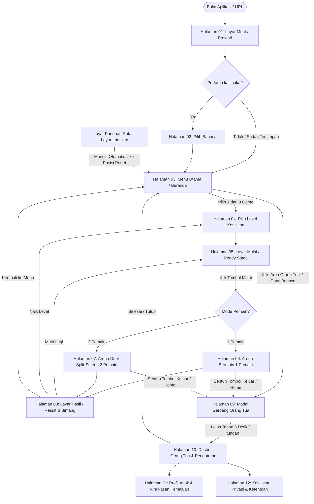

# PRD Halaman (page.prd) — Play with Ms Ziya

Dokumen ini mendefinisikan seluruh halaman (layar), diagram alur pengguna (*screen flowchart*), dan rincian konten tiap halaman pada aplikasi **Play with Ms Ziya** (usia 4–6 tahun).

---

## 1. Diagram Alur Halaman (Page Flowchart)

---

## 2. Daftar & Rincian Konten Setiap Halaman

---

### Halaman 01: Layar Muat (Preload / Boot)
- **Tujuan:** Menyiapkan aset grafis, web fonts, dan audio sprite di memori peramban tanpa membuat anak bosan.
- **Isi & Elemen:**
  - Latar belakang kuning cerah dengan huruf-huruf dekoratif samar (`A`, `B`, `1`, `ا`).
  - Animasi maskot **Ms Ziya** menyapa ceria dengan balon sapaan *"Hi!"*.
  - Logo utama *"Play with Ms Ziya"* berbingkai tebal.
  - Bilah kemajuan muat berbentuk kapsul kuning bertuliskan *"Memuat… / Loading…"*.
  - Deteksi orientasi layar (memaksa tampilan lanskap).

---

### Halaman 02: Pemilih Bahasa Awal (Language Select)
- **Tujuan:** Menentukan bahasa instruksi suara dan teks antarmuka sejak awal penggunaan.
- **Isi & Elemen:**
  - Judul ramah: *"Pilih Bahasa / Choose Language"*.
  - Dua kartu tombol sentuh raksasa:
    1. 🇮🇩 **Bahasa Indonesia**
    2. 🇬🇧 **English**
  - Efek suara pengucapan otomatis nama bahasa saat disentuh.
  - Menyimpan preferensi ke penyimpanan lokal (*localStorage*).

---

### Halaman 03: Menu Utama (Beranda / Home Screen)
- **Tujuan:** Pusat navigasi utama anak untuk memilih permainan, melihat koleksi bintang, dan memilih mode permainan.
- **Isi & Elemen:**
  - **Header Atas:**
    - Logo *"Play with Ms Ziya"* berdampingan dengan avatar maskot.
    - Tombol utilitas: Pemilih Bahasa (`ID/EN` berikon gembok), Tombol Layar Penuh (`⛶`), dan Tombol Suara (`🔊`).
  - **Baris Tab Kategori (Filter Bar):**
    - ☀️ *Semua Mainan* (menampilkan 9 game).
    - 🔢 *Angka (1 2 3)* (filter 2 game angka).
    - 🔤 *Huruf (A B C)* (filter 3 game huruf).
    - 🌙 *Hijaiyyah (ا ب ت)* (filter 2 game hijaiyyah).
    - 🧩 *Ingat & Main* (filter 2 game daya ingat).
  - **Grid Permainan (9 Kartu Permainan):**
    1. *Ayo Berhitung* (Kategori Angka · Usia 4-6 th · Visual: Apel, Pisang, Keranjang 123).
    2. *Menulis Angka* (Kategori Angka · Usia 4-6 th · Visual: Angka 5 Tracing).
    3. *Susun Kata* (Kategori Huruf · Usia 4-6 th · Visual: Balok huruf [A][P][E][L]).
    4. *Bunyi Awal* (Kategori Huruf · Usia 4-6 th · Visual: Anak ayam "B-b-Burung").
    5. *Menulis Huruf* (Kategori Huruf · Usia 4-6 th · Visual: Huruf A & Pensil).
    6. *Dengar & Temukan* (Kategori Hijaiyyah · Usia 4-6 th · Visual: Huruf ب & Speaker).
    7. *Tebalkan Hijaiyyah* (Kategori Hijaiyyah · Usia 4-6 th · Visual: Huruf Dotted ج).
    8. *Kartu Kembar* (Kategori Ingat & Main · Usia 4-6 th · Visual: Pasangan Kartu Bintang).
    9. *Petualangan Labirin* (Kategori Ingat & Main · Usia 4-6 th · Visual: Kue manis & Labirin).
    - Tiap kartu dilengkapi rating capaian bintang (`★★★`).
  - **Dock Status Bawah:**
    - Modul Profil Anak: Avatar, nama panggilan (*"Adik Bintang"*), streak hari bermain.
    - Modul Bintang: Ikon bintang emas & total bintang terkumpul (*"12 Bintang"*).
    - Toggle Mode Cepat: `[ 👤 1 Pemain ]` vs `[ 👥 2 Pemain ]`.
    - Tombol Area Orang Tua: Tombol gembok proteksi (*"Tahan 3 Detik"*).

---

### Halaman 04: Pemilih Level Kesulitan (Level Select)
- **Tujuan:** Menentukan tingkat tantangan materi belajar sesuai kesiapan anak.
- **Isi & Elemen:**
  - Header: Nama game terpilih + tombol kembali ⬅️.
  - 3 Tombol kartu tingkat kesulitan:
    - ★ **Mudah:** Pilihan jawaban sedikit, petunjuk visual aktif, jalur tracing lebar & toleran.
    - ★★ **Sedang:** Pilihan jawaban bertambah, petunjuk mulai dikurangi.
    - ★★★ **Menantang:** Jumlah pilihan maksimal/huruf mirip, tanpa garis bantu, jalan buntu pada labirin.
  - Semua level terbuka bebas (tidak dikunci paksa agar anak bebas bereksplorasi).

---

### Halaman 05: Layar Mulai Permainan (Ready / Stage Intro)
- **Tujuan:** Memberikan fokus, instruksi verbal, dan kesempatan bagi anak menyimak sebelum interaksi dimulai.
- **Isi & Elemen:**
  - Ilustrasi tematik besar karakter/objek permainan.
  - Judul game & keterangan level yang dipilih.
  - Panduan suara otomatis oleh Ms Ziya (contoh: *"Dengarkan bunyinya, lalu ketuk huruf yang pas ya!"*).
  - Tombol pemutar ulang suara 🔊.
  - Tombol aksi utama raksasa: **"Klik Mulai / Click Start"** dengan ikon panah tebal ▶️.

---

### Halaman 06: Arena Bermain — Mode 1 Pemain (Single Player Stage)
- **Tujuan:** Kanvas interaktif utama tempat anak menyelesaikan tantangan secara mandiri.
- **Isi & Elemen:**
  - **Top HUD Bar:** Tombol Home/Keluar (dilindungi konfirmasi gerbang), indikator progres bintang sesi, tombol layar penuh, tombol mute suara.
  - **Kanvas Interaksi Tengah (Sesuai Game):**
    - *Game Tracing (H-02, A-02, L-03):* Jalur putus-putus polyline, partikel kilau saat jari menelusuri, panah animasi awal.
    - *Game Pilihan (H-01, L-02):* Kartu pilihan besar (≥ 160 px), speaker dengar ulang bunyi kata.
    - *Game Berhitung (A-01):* Objek buah/hewan interaktif, keranjang penampung, kartu angka pembanding.
    - *Game Susun Kata (L-01):* Gambar soal, slot kotak huruf sasaran, kepingan balok huruf acak.
    - *Game Kartu Kembar (G-01):* Grid kartu bertutup motif bintang, efek flip 3D saat disentuh.
    - *Game Labirin (G-02):* Peta labirin, karakter anak/hewan yang digeser jari, rintangan dinding bergetar lembut, titik akhir makanan manis.
  - **Asisten Maskot (Pojok Bawah):** Ms Ziya memberikan ekspresi penyemangat dan balon petunjuk otomatis jika anak diam selama > 30 detik.

---

### Halaman 07: Arena Bermain — Mode 2 Pemain (Duel Split-Screen)
- **Tujuan:** Bermain bersama saudara/teman sebaya secara langsung berhadapan atau berdampingan pada satu tablet/layar sentuh.
- **Isi & Elemen:**
  - Layar terbelah dua zona simetris:
    - **Sisi Kiri / Bawah:** Wilayah Pemain 1 (Latar Biru Langit).
    - **Sisi Kanan / Atas:** Wilayah Pemain 2 (Latar Oranye Ceria).
  - Isolasi sentuhan multi-touch: Sentuhan jari Pemain 1 tidak akan mengganggu atau membatalkan sentuhan Pemain 2.
  - Soal yang sama muncul bersamaan di kedua sisi.
  - Skor/bintang mini di sudut masing-masing pemain.
  - *Aturan Khusus Kartu Kembar:* Sistem giliran bergantian dengan lampu sorot visual pada pemain yang aktif.

---

### Halaman 08: Layar Hasil & Bintang (Result Screen)
- **Tujuan:** Memberikan apresiasi penuh atas usaha anak tanpa ada rasa takut kalah.
- **Isi & Elemen:**
  - Animasi selebrasi: Maskot Ms Ziya bertepuk tangan riang + hujan konfeti ramah.
  - Bintang hasil bermain (1 hingga 3 bintang) muncul bertahap dengan fanfare riang.
  - Suara pujian verbal: *"Hebat sekali!", "Bagus!", "Kamu pintar!"*.
  - *Pada Mode 2 Pemain:* Mahkota kecil di atas pemain poin tertinggi, namun **kedua anak tetap menerima bintang**.
  - **3 Tombol Navigasi Bawah:**
    1. 🔁 **Main Lagi** (mengulang game dan level yang sama).
    2. ⬆️ **Naik Level** (melangkah ke tingkat kesulitan berikutnya).
    3. 🏠 **Menu** (kembali ke Menu Utama).

---

### Halaman 09: Modal Gerbang Orang Tua (Parental Gate)
- **Tujuan:** Menjaga agar anak tidak keluar game secara tak sengaja atau mengubah setelan penting aplikasi.
- **Isi & Elemen:**
  - Pop-up modal semi-transparan yang memblokir interaksi di belakangnya.
  - Instruksi untuk orang dewasa dalam dua opsi verifikasi:
    - *Opsi 1 (Gesture):* Menahan tombol sentuh selama 3 detik penuh (dengan animasi lingkaran pengisi).
    - *Opsi 2 (Kognitif):* Menyelesaikan pertanyaan matematika dasar acak (contoh: *"Berapa 4 + 3?"*).
  - Tombol batal silang ✖️ untuk kembali ke layar sebelumnya.

---

### Halaman 10: Dasbor Orang Tua & Pengaturan (Parent Dashboard)
- **Tujuan:** Ruang khusus orang tua untuk mengatur preferensi teknis dan akun pendamping.
- **Isi & Elemen:**
  - **Panel Pengaturan Game:**
    - Ganti Bahasa Utama (Indonesia / English).
    - Kontrol Volume BGM (Musik Latar) & SFX (Suara Panduan).
    - Mode *"Kurangi Gerakan / Reduce Motion"* (ramah anak sensitif animasi).
  - **Panel Akun & Autentikasi (Opsional):**
    - Masuk dengan Magic Link Email / OTP / Akun Google.
    - Keterangan privasi: *"Data bermain anak tersimpan aman dan privat"*.
  - Tombol menuju Halaman Profil Kemajuan Anak & Halaman Kebijakan Privasi.
  - Tombol keluar dari area orang tua.

---

### Halaman 11: Profil Anak & Ringkasan Kemajuan (Progress Summary)
- **Tujuan:** Menampilkan laporan aktivitas bermain dan pencapaian kompetensi anak dalam bahasa yang mudah dimengerti orang tua.
- **Isi & Elemen:**
  - Pengaturan profil: Nama panggilan anak (tanpa nama lengkap) dan pilihan ikon avatar.
  - Daftar indikator capaian *"Sudah Bisa..."*:
    - *Angka:* Berhitung 1–5, 1–10, 1–20; Menulis angka 0–9, 10–20.
    - *Huruf:* Mengenali bunyi fonik huruf; Menyusun kata sederhana 3–4 huruf; Menulis alfabet A–Z.
    - *Hijaiyyah:* Hafal bunyi 10/20/28 huruf hijaiyyah; Menelusuri jalur huruf hijaiyyah.
    - *Daya Ingat:* Menyelesaikan kartu memori 3/6/10 pasang; Menemukan jalan labirin.
  - Label status: *"Sudah Dikuasai ✅"* (jika konsisten ≥ 80% benar) atau *"Sedang Dilatih ⏳"*.
  - Opsi hapus data profil anak / reset progres bermain.

---

### Halaman 12: Kebijakan Privasi & Ketentuan (Privacy Policy)
- **Tujuan:** Memenuhi standar hukum perlindungan privasi data anak (tanpa pelacak iklan, tanpa penjualan data).
- **Isi & Elemen:**
  - Teks penjelasan transparan dalam Bahasa Indonesia dan Bahasa Inggris.
  - Pernyataan kepatuhan privasi:
    - Tidak mengumpulkan nama lengkap, lokasi, kamera, atau mikrofon anak.
    - Penyimpanan lokal di perangkat; data akun orang tua hanya berupa email dan nama panggilan.
  - Tombol kembali ke Dasbor Orang Tua.

---

### Halaman Khusus: Layar Pengaman Orientasi (Orientation Guard)
- **Tujuan:** Memastikan kenyamanan bermain tetap pada kanvas lanskap 16:9.
- **Kondisi Muncul:** Otomatis mengambil alih layar jika perangkat diputar ke posisi potret (tegak).
- **Isi & Elemen:**
  - Animasi ilustrasi tablet berputar dari posisi tegak ke posisi mendatar (lanskap).
  - Pesan visual dan teks singkat: *"Putar layarmu ke samping ya!" / "Please rotate your screen!"*.

---

## 3. Matriks Kategori Soal & Permainan

| ID Game | Nama Permainan | Kategori | Jenis Materi / Soal | Cara Bermain |
| :--- | :--- | :--- | :--- | :--- |
| **A-01** | Ayo Berhitung | Angka | Mengenal kuantitas angka 1–20 melalui objek buah, hewan, balon | Ketuk objek satu per satu ke keranjang, lalu pilih kartu angka yang sesuai |
| **A-02** | Menulis Angka | Angka | Garis bentuk angka 0–9 (level 1), 10–15 (level 2), 16–20 (level 3) | Menelusuri jalur angka dengan jari sesuai panah panduan |
| **L-01** | Susun Kata | Huruf | Ejaan kata 3 huruf (apel, tas), 4 huruf (bola, buku), 5-6 huruf | Menyeret kepingan huruf alfabet ke dalam kotak urutan yang benar |
| **L-02** | Bunyi Awal | Huruf | Pengenalan fonik suara huruf awal kata benda | Mendengarkan pengucapan bunyi awal, lalu mengetuk huruf alfabet yang tepat |
| **L-03** | Menulis Huruf | Huruf | Bentuk alfabet kapital A–Z dan huruf kecil a–z | Menelusuri goresan bentuk huruf menggunakan jari |
| **H-01** | Dengar & Temukan | Hijaiyyah | Suara lafal huruf hijaiyyah tunggal (Alif sampai Ya) | Menyimak ucapan Ms Ziya, kemudian memilih kartu huruf hijaiyyah yang cocok |
| **H-02** | Tebalkan Hijaiyyah | Hijaiyyah | Pola goresan garis huruf hijaiyyah dan titik (nuqtah) | Menebalkan garis putus-putus huruf hijaiyyah dari titik awal hingga tuntas |
| **G-01** | Kartu Kembar | Ingat & Main | Daya ingat visual (gambar buah, hewan, angka, atau huruf) | Membalik 2 kartu tertutup untuk mencari pasangan gambar yang identik |
| **G-02** | Petualangan Labirin | Ingat & Main | Pemecahan masalah spasial dan konsentrasi navigasi jalur | Menyeret karakter melewati lorong labirin tanpa menabrak dinding menuju makanan |
